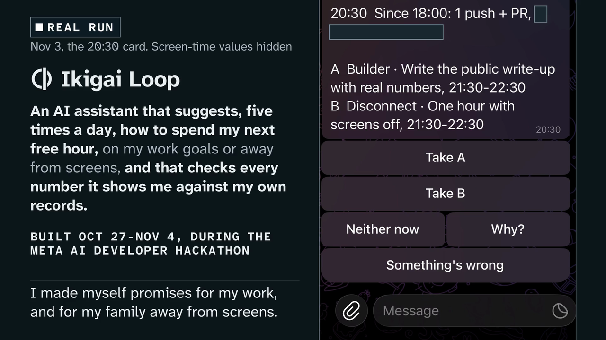
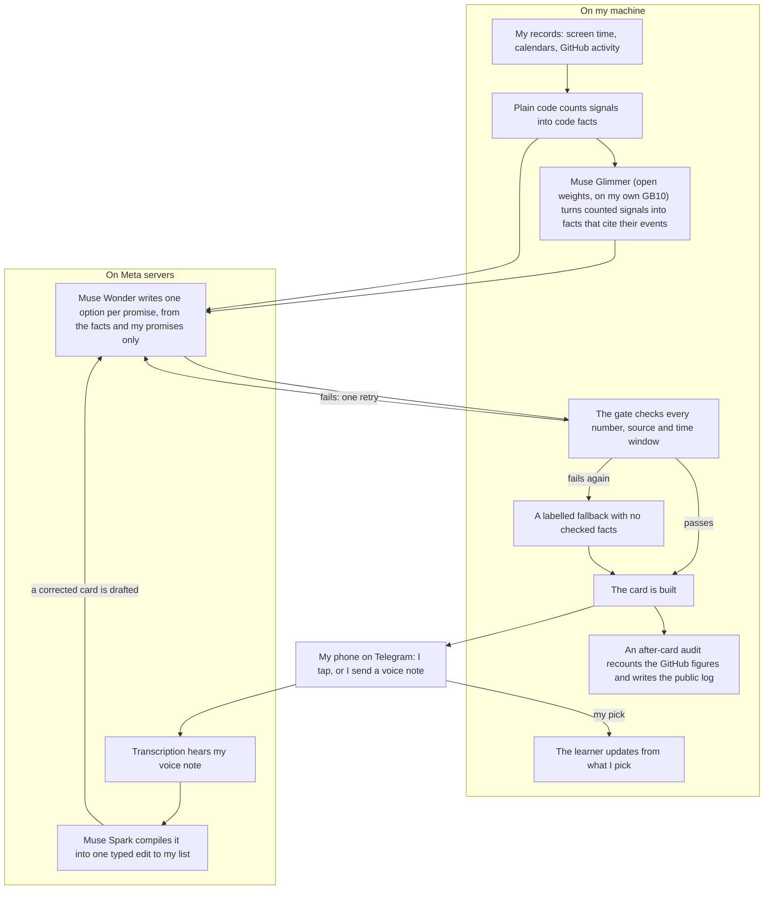
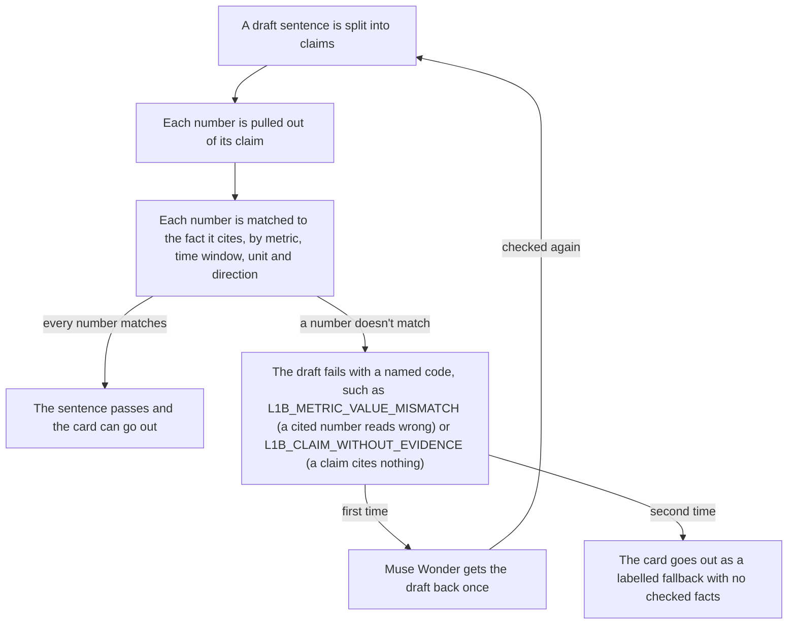
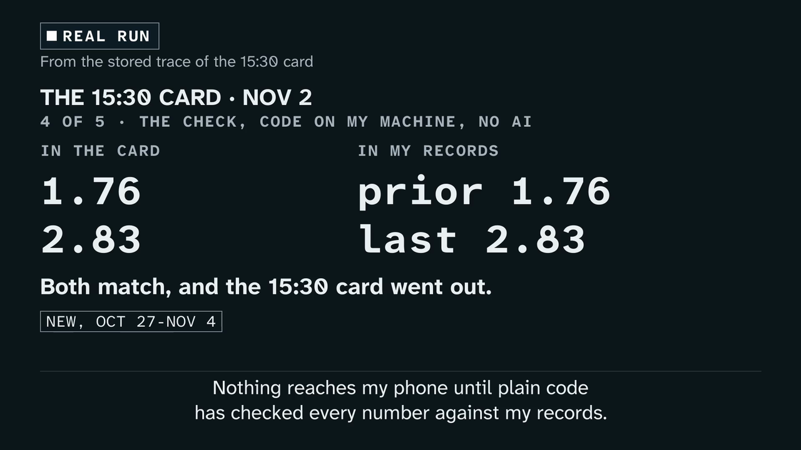
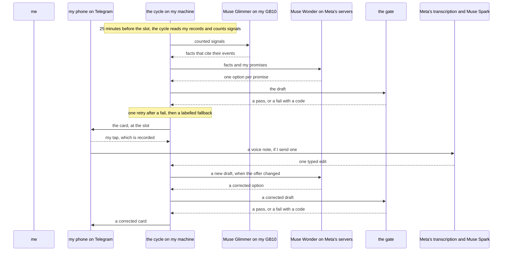
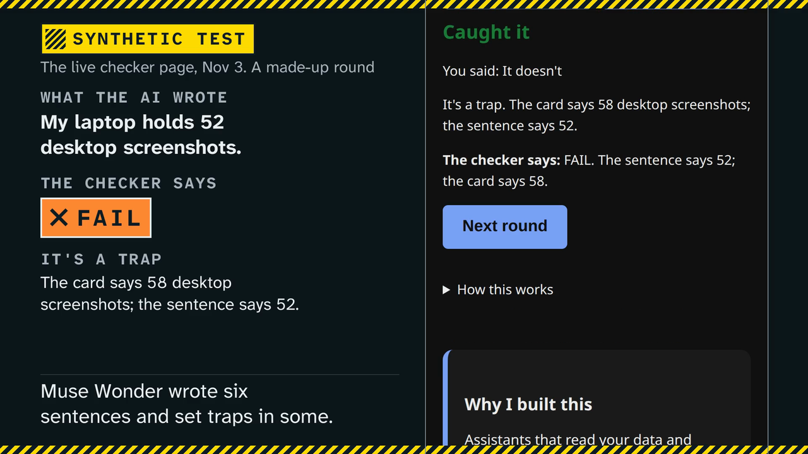

# Ikigai Loop

I made myself two promises: do my work, and spend time with my family away from screens. Most hours can only go to one of them. Ikigai Loop is the assistant I built to help me choose, and I'm its first user: I set my goals, made my promises and set up its signals.

**Why it exists.** Wanting something and doing it are far apart: in a meta-analysis, "a medium-to-large change in intention (d = 0.66) leads to a small-to-medium change in behavior (d = 0.36)" (Webb & Sheeran 2006), and in Emmons & King (1988), "Subjects were less likely to act on conflictful and ambivalent strivings", like my two promises. An assistant that offers the next free hour at the moment of choice could help, but only if I can trust what it says about my own life. Models write fluent sentences that quote the wrong number: across four generative search engines, "a mere 51.5% of generated sentences are fully supported by citations" (Liu, Zhang & Liang 2023). So no card reaches my phone until plain code has checked every number in it against my records, and the same check can test the numbers in any sentence an AI writes about a record.



Four Meta models do the work: Muse Wonder writes the two options, Muse Glimmer (open weights, on my own GB10) turns my records into facts, Muse Spark turns a voice note into one edit to my list, and Muse Code wrote the code. Plain code checks every number.

That check works on your own numbers too, on [the checker page](https://carloscrespomacaya.com/ikigai-loop/verify/): give it a card and a sentence, and it flags a sentence that says 12 deploys when the card says 7. An engineer outside the project tried it on an example from their own work: it passed the matching figure and flagged the mismatch once they changed the record. It also runs on public data with known answers: on UCI bike-share and home-energy records it stopped 120 of 120 planted errors and passed 38 of 38 true claims ([docs/domains.md](docs/domains.md)).

Five times a day it reads my calendar and offers my next free hour to those two promises, one option for each, and I choose with a tap. Each card shows what changed since the last one, the free hour and both options; one tap on Why? shows the numbers behind each option, like "Prs rose by 11 since the last card" (PRs are pull requests on GitHub).

Before a card reaches my phone, it checks every number on it against my records. Afterwards, it checks the option I pick against the traces it should have left, such as pushes to GitHub for work. Where nothing can be measured, it rests on my word: I'm doing this to fix something for myself, so I have no reason to cheat.

Code checks the numbers I can measure, such as my pull requests on GitHub. It can't check that a sentence is true, or the parts that rest on my word. [Misses so far: see TRUST.md](docs/TRUST.md)

Why check numbers separately: the assistant writes friendly sentences, and a friendly sentence can sound sure while quoting the wrong number. Numbers can be counted and checked, sentences can't, so plain code checks the numbers. On Nov 2 mine passed "Prs rose by 3 in the last period": the right number, from the wrong window. A test that fails on that sentence came first, then the rule, and the Nov 3 11:30 card said "Prs rose by 11 since the last card".

I've used it myself for the past few days. The first real card reached my phone on Nov 2 at 13:30, on time, and I chose with a tap. An independent recount of its pull-request figure, straight from GitHub's own records rather than from my store, matched. The whole live run in numbers, misses included: [docs/live-run.md](docs/live-run.md).

You can try the same check with nothing to install: [the checker page](https://carloscrespomacaya.com/ikigai-loop/verify/) opens on a game, Catch the AI. Muse Wonder wrote six sentences and set traps in some. Can you beat the checker? It runs in your browser.

## How it works

It looks at what I actually did, from my screen time, calendar and GitHub, picks two options from a list of promises I wrote down myself, and sends them to my phone as a Telegram card. Before the card goes out, plain code checks every figure in it, say "you coded 4.7 hours yesterday", against those records, and a wrong one is sent back. I choose with a tap, or correct it with a voice note, and later cards learn from what I pick.

### One card, end to end



Follow the arrows: the gate sits between every draft and my phone, and Muse Wonder sees facts and promises, never my raw records.

### What the number check does



A draft with a wrong number gets one retry; if it fails again, the card goes out as a labelled fallback with no checked facts, never with the wrong number.



### One card, in time



Read it top to bottom: one card from my records to my phone, then a voice note that corrects it.

## Try it

One command for a stranger. You need `uv` and `git`, and a network connection the first time; uv fetches Python itself if needed. It runs with no key, no model, no phone and no account, stores nothing, writes only the file you name (uv keeps its own download cache, as it does for any tool), and reads no real data:

```sh
uvx --from git+https://github.com/macayaven/ikigai-loop try-ikigai --save card.png
```

It replays made-up data through the same checks my real run uses and prints the card, the choice, a planted wrong number the gate rejects, and the records behind one sentence; `card.png` is the chart image. On my machine the first run took under 10 seconds from an empty cache, Python download included, and about a second after that.

From a clone, `make try` runs the same replay.

## Check your own agent

If your agent says it shipped 12 deploys and your records say 7, the checker catches it.



The number, source, label, direction, negation, quantity-form, unit and period checks in my gate also run on your agent's output, against records you supply. You need `uv` for the command below; the browser page needs nothing, and takes the sentence and your records in plain words, with no JSON. Grab the worked input and run the checker:

```sh
curl -sLO https://raw.githubusercontent.com/macayaven/ikigai-loop/main/examples/verify/input.json
uvx --from git+https://github.com/macayaven/ikigai-loop verify-claims input.json; echo exit=$?
```

You should see exit 1 with `L1B_METRIC_VALUE_MISMATCH`: the sample says
November deploys reached 12 while the records say 7. Or run it in your
browser at [https://carloscrespomacaya.com/ikigai-loop/verify/](https://carloscrespomacaya.com/ikigai-loop/verify/), where the same Python runs
on your machine and nothing is sent anywhere. The Python function verify_claims keeps the earlier, smaller set of checks; the command line and this page run the wider checker described here.

An engineer outside the project tried it on an example from their own work. It passed the matching figure, and flagged the mismatch once they changed the record: within a second, by their account. Their one complaint was having to copy the exact JSON shape; the browser page's form takes plain words instead.

This check covers parseable numbers, cited sources, labels, direction, negation, quantity forms, and units and periods where you declare them. It does not check that a sentence is true. Without labels it cannot tell which metric a number belongs to, and a cited fact is only checked to exist. A check listed as not checked did not run.

What this checker does not check: it never checks that a sentence is true; a word after a number that is not a unit, a magnitude or a percent form isn't checked; disguised spellings of your private terms aren't caught; advice and instructions in the text aren't caught unless you list advice words.

Disclosed limit: a unit word that agrees with one cited metric can still fail against another, because the sentence does not say which metric the word belongs to.

Start from [examples/verify/README.md](examples/verify/README.md) for the
full worked case, and [docs/ADAPTER.md](docs/ADAPTER.md) to map your own
agent's output shape to this input.

## Results

On Nov 2, Muse Glimmer ran on my own hardware for every scheduled live card: all 5 slots, two passes each, and 3 of those 5 cards cite at least one of its facts (docs/provenance.jsonl). Muse Glimmer has generated facts through this code in a seeded run on synthetic data. Muse Wonder has written proposals through this code on synthetic data, on Muse Code headless on my subscription, with the numbers in [docs/sessions/011-wonder-proposal.md](docs/sessions/011-wonder-proposal.md). A full synthetic slot ran through this code on my local model and Muse Wonder, with a scratch database and a fake Bot API, as [docs/sessions/013-orchestrator.md](docs/sessions/013-orchestrator.md) records. The first real card went out on Nov 2 at 13:30, on time, as the public line in `docs/provenance.jsonl` records. I tapped my choice. An independent recount of its pull-request figure from GitHub's own records matched at every stage, as [docs/sessions/020-source-audit.md](docs/sessions/020-source-audit.md) records under "The first real card". The registered run continues to Nov 4 and I claim no results before it ends.

| What I measured | The result |
|---|---|
| The gate on synthetic briefings | Catches all 119 mutant briefings and passes all 57 known-good ones ([status](docs/status.md)) |
| Attacks from two red-team rounds | Stops 64 of the 66 ([status](docs/status.md)) |
| The checker on public records from two other domains | Stopped 120 of 120 planted errors and passed 38 of 38 true claims ([domains](docs/domains.md)) |
| Voice correction on 60 fixed notes | The default arm got 58 of 60 ([status](docs/status.md)) |
| Calendar labels on 80 invented titles | Model correct 77/80 ([status](docs/status.md)) |
| The first real card | Out on time on Nov 2 at 13:30, and the recount of its pull-request figure matched ([live run](docs/live-run.md)) |

Every benchmark, its tests and its limits: [docs/status.md](docs/status.md). The live run in numbers, misses included: [docs/live-run.md](docs/live-run.md).

## What the research changed

Eight of the papers in docs/LITERATURE.md each changed a specific part of this repo:

| Idea and source | Where it lives | What it changed |
|---|---|---|
| If-then plans, Gollwitzer and Sheeran 2006 | [profiles/commitments.example.json](profiles/commitments.example.json) | I give each commitment a set time, so it reads like an action plan. |
| Feedback on behaviour, Harkin et al. 2016 | [framework/cycle/slot_ledger.py](framework/cycle/slot_ledger.py) | I record what happens in my ledger. |
| Self-determination, Ryan and Deci 2000 | [framework/briefing/commitments.py](framework/briefing/commitments.py) | I keep the commitments mine, and I can always refuse. |
| Unsupported cited sentences, Liu, Zhang and Liang 2023 | [framework/briefing/gate.py](framework/briefing/gate.py) | I make plain code reconcile every number against its cited source. |
| Atomic facts, Min et al. 2023 | [framework/rater/split.py](framework/rater/split.py) | I rate atomic claims in R1, apart from my gate parser matching a number. |
| Invariance and directional tests, Ribeiro et al. 2020 | [evals/r3.py](evals/r3.py) | I built R3 on these, with my own thresholds and my own expected picks. |
| Unfaithful model explanations, Turpin et al. 2023 | [evals/r4.py](evals/r4.py) | I perturb cited facts in R4 instead of trusting a stated reason. |
| Pre-registration, Nosek et al. 2018 | [docs/PREREG.md](docs/PREREG.md) | I register first, then I log deviations by date. |

These papers ground my choices and methods, but they do not show that my product works; [docs/LITERATURE.md](docs/LITERATURE.md) holds the full table.

## What works today, and what doesn't

Works: cards reach my phone five times a day on a schedule, and the first real one went out on time. Every figure on a card is checked against my records by plain code with no model before it is sent, and a recount of the first card's pull-request figure from GitHub matched. A voice note can correct a card, and that code is built. Anyone can run the checker on their own agent, on the command line or in the browser.

Doesn't, yet: this is set up for one person, me, with no installer and no ready-made timer files in the repo. The run I registered before the first card continues to Nov 4 and I will report its numbers then. There is no viewer for past cards.

This is for me first, and the checker is for anyone whose agent cites numbers.

## Built during the hackathon

Every commit here falls inside the building period, Oct 27 to Nov 4, first commit e62fcc8. Not built here: Meta's model weights, Unsloth's GGUF quantization of Glimmer, llama.cpp and llama-swap, ActivityWatch, Telegram, and my accounts and hardware. Muse Code wrote the code; the exceptions, such as held-out test sets and one frozen baseline written by Claude Code, are named in [CONTRIBUTIONS.md](CONTRIBUTIONS.md), and the full record is in [docs/sessions/](docs/sessions/).

## No medical advice

It gives no medical advice by design: it only schedules commitments I wrote, and Apple Health is out of the design. The gate enforces this with two rules: `L1_ACTION_NOT_COMMITTED` rejects any action that isn't one of those commitments, and `L1_ADVICE` rejects advice wording in claims and actions. `L1_ADVICE` is a fixed word list, so it catches wording, not meaning.

## Documentation

| Page | What it holds |
|---|---|
| [docs/status.md](docs/status.md) | The build record: what is built, what is not, and what the loop needs. |
| [docs/architecture.md](docs/architecture.md) | The parts of the loop and how they call each other. |
| [docs/glossary.md](docs/glossary.md) | The words I use, and the diagram I borrowed. |
| [docs/live-run.md](docs/live-run.md) | The live run in numbers, misses included. |
| [docs/TRUST.md](docs/TRUST.md) | What the loop still misses. |
| [docs/MODELS.md](docs/MODELS.md) | Which model does what on each card. |
| [docs/PRIVACY.md](docs/PRIVACY.md) | What stays on my machine and what leaves it. |
| [docs/PREREG.md](docs/PREREG.md) | The plan I registered before the first card. |
| [docs/LITERATURE.md](docs/LITERATURE.md) | The papers behind my choices. |
| [docs/domains.md](docs/domains.md) | The checker on public records from two other domains. |
| [docs/r9-audio.md](docs/r9-audio.md) | Voice correction through spoken audio, in my cloned voice. |
| [docs/glimmer-evidence.md](docs/glimmer-evidence.md) | Proof that Glimmer runs on my own hardware. |
| [docs/ADAPTER.md](docs/ADAPTER.md) | How to map your own agent to the checker. |
| [CONTRIBUTIONS.md](CONTRIBUTIONS.md) | Who built what, and with which models. |

## Links

- The two goals: [profiles/](profiles/)
- Design record and past plans: [docs/](docs/)
- What the literature supports and doesn't: [docs/LITERATURE.md](docs/LITERATURE.md)

## License

The code is under the Apache License 2.0; see [LICENSE](LICENSE).
