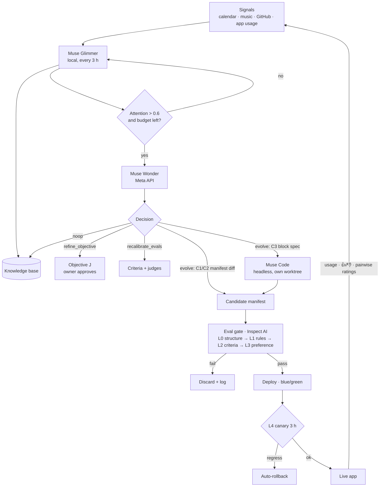

# Ikigai Loop: Build Spec v0.3 (one person, two objectives)

Meta AI Developer Hackathon · indie track · theme "Build for Your World"
Status: draft v0.3, 2026-10-27 · Author: Carlos · Submission due 2026-11-04 21:00 ET
Previous versions: v0.1 (naive design) and v0.2 (two people), not included in this repo.

> **Pitch.** Same code, same person, same signals, two objective functions: two apps that end up with nothing in common.
> **Thesis for the judges.** Self-improving software is only worth trusting if the evaluator is trustworthy. So we built the evaluator first, measured it against a human, and let the system earn its autonomy.

---

## 0.1 What changed in v0.3 and why

v0.2 involved a second person who isn't a registered participant. That meant third-party personal data, a consent process and an open eligibility question. v0.3 keeps "two apps from one framework" but makes it a controlled experiment on one person:

| | v0.2 | v0.3 |
|---|---|---|
| Subjects | 2 people | 1 person (Carlos), 2 **objective profiles** |
| Inputs | different signals per person | **identical** signal stream for both profiles |
| What varies | life + objective | **only the objective** (ikigai statements, weights, criteria) |
| Divergence means | "different people got different apps" | "the objective function caused the difference" |
| Final test | blind cross-preference (each person picks their own) | **blind attribution**: raters match apps to objectives without labels |
| Third-party data | the friend's, with consent | none |

Profiles (names provisional):
- **A · Builder.** Ship the hackathon, top-lab interview, the public write-up.
- **B · Recovery.** Rest, family, music, the people around me.

Both are real sides of the same week, so usage and feedback signals stay honest. Neither is a role-played persona.

## 0. What changed from v0.1 and why

| Risk in v0.1 | Remediation in v0.2 | Section |
|---|---|---|
| **Generic apps.** Free-form code generation drifts to the same dashboards for everyone | App = **manifest of typed blocks** from a fixed library. Most evolution is composing and configuring blocks. New blocks are rare and gated harder | 3 |
| **Abstract demo.** "An app that changes itself" is invisible in 3 minutes | Manifest diffs make every change visible; in-app **"why I changed"** changelog; side-by-side block layouts as the hero visual | 3, 10 |
| **Time.** Self-modifying loops break; day 0 in 2 days | **Eval harness first**, then loop. Manifest-level evolution needs no coding agent, so the loop works even if Muse Code can't run headless. Dry-run nights on synthetic personas before real users | 4, 9 |
| **"LLM grading an LLM."** Judge opinion dominates J | Binary criteria instead of Likert, a **jury** of judges, position swapping, judge validated against human labels with Cohen's κ, hidden held-out criteria, meta-eval of the gate | 5 |
| **Unattended autonomy.** Bad changes ship overnight | **Autonomy levels earned by measured agreement.** Starts at propose-only; promoted only when κ clears a threshold; demoted automatically | 5.5 |
| **Thin data, n=2** | Add 3 **synthetic personas** (labelled as such) to test divergence at n=5; real-data claims kept to the 2 real profiles | 5.8 |

## 1. Goals, non-goals, scope

**Goals**
1. An evaluation framework strong enough to let software change itself unattended: validated against human judgment, adversarially tested, logged.
2. Two objective profiles (A Builder, B Recovery) fed the **same signals** from one day-0 commit, diverging into apps that blind raters can attribute to the right objective.
3. Real numbers for the submission and the write-up, failures included.

**Non-goals:** multi-tenant product, scraping, native app, statistical claims beyond one person and two objectives.

**Scope (MoSCoW)**

| Must | Should | Could | Won't |
|---|---|---|---|
| Block library (10 blocks), manifest schema, renderer | Muse Code generating new blocks | Simulated hackathon judge panel for Carlos | Free-form app rewrites |
| Inspect AI eval suite + meta-eval | Autonomy level A2 | Spotify playback inside the app | Social network data |
| Glimmer cycle, Wonder decisions, manifest diffs | L3 canary | Public demo instance on fixtures | Multi-user auth |
| Autonomy A0/A1, rollback, kill switch | Synthetic personas ×3 | | |
| Calibration UI (pairwise ratings), blind attribution test | Langfuse runtime traces | Null-objective control profile (equal weights, no statements) | |

## 2. Hard constraints

| Source | Constraint | Enforcement |
|---|---|---|
| Hackathon rules | Public repo; only work built during the event; no code/data/assets without rights; my contributions identifiable | Fresh repo; `CONTRIBUTIONS.md`; gate L1 |
| Eligibility | Only Carlos is registered and only Carlos's data is used | All commits by Carlos; no third-party data; advisory AI use disclosed in `CONTRIBUTIONS.md` |
| Privacy | No personal data in repo or traces; ikigai texts published only as far as Carlos chooses | L1 PII + secret scan; fixtures only; redaction before tracing |
| Secrets | keys from environment at runtime | `gitleaks` pre-commit and in L1 |
| Local models | one local OpenAI-compatible endpoint via `LOCAL_LLM_BASE_URL` | Single client module |
| Operator window | Correct with operator offline ~13.5 h/day (window 13:00–23:30) | Section 7 |

## 3. Design space: apps as manifests of blocks

The single biggest de-risk. Muse Code doesn't rewrite the app; the app is data.

```jsonc
// manifest (per profile, versioned)
{
  "version": "recovery-v14",
  "parent": "recovery-v13",
  "layout": ["playlist#evening", "checkin#energy", "calendar_slots#family_call", "focus_session#rest"],
  "blocks": {
    "playlist#evening": {
      "type": "playlist", "dimension": "love",
      "config": { "label": "Wind down", "source": "recently_played", "suggest_when": "after_21h" },
      "rationale": "energy check-ins below 3 on 4 of the last 5 evenings; love weight 0.35"
    }
  },
  "changelog": [{ "from": "v13", "change": "added calendar_slots#music_time", "why": "...", "evidence": ["fact:212"] }]
}
```

**Block library v0** (each = Pydantic config schema + renderer + tests + allowed dimensions)

| Block | Does | Data |
|---|---|---|
| `checklist` | Short list with done state | local |
| `focus_session` | Timer with goal and log | local |
| `habit` | Streak tracker | local |
| `checkin` | 1-tap mood / energy | local |
| `calendar_slots` | Finds and proposes free slots matching a rule | Calendar (read) |
| `playlist` | Curated list / link with reason | Spotify (read) |
| `metric_chart` | Plots a tracked value over time | local |
| `insight_card` | Daily short text generated by Glimmer from KB facts | KB |
| `countdown` | Days to a date with prompt | local |
| `link_list` | Curated resources | none |

**Change levels**

| Level | Example | Produced by | Gate |
|---|---|---|---|
| C1 configure | change timer to 25 min, rename, retarget | Wonder (manifest diff) | standard |
| C2 compose | add / remove / reorder existing blocks | Wonder (manifest diff) | standard |
| C3 new block | a block type that doesn't exist yet | Wonder spec → Muse Code | standard + block test suite + max 1/day/profile |

Divergence becomes measurable: Jaccard distance on block-type sets, plus config edit distance.

**What is shared and what is per profile.** This is what makes the experiment controlled:

| Shared (one copy) | Per profile |
|---|---|
| Signal adapters and `events` | ikigai statements, weights, criteria (visible + hidden) |
| Glimmer fact extraction (objective-agnostic facts) | dimension tagging of facts, attention score, Wonder budget |
| Block library, gate code, jury models | manifests, deploys, rollback pointer, autonomy level, κ |
| | **feedback**: usage, 👍/👎, ratings from app A train A only, from app B train B only |

Glimmer extracts facts once. Each profile then reads them through its own objective.

## 4. The loop

Unchanged in shape from v0.1, narrower in what it can do.



| Component | Runs on | Does | Never |
|---|---|---|---|
| Adapters | Spark | Calendar, Spotify, GitHub, app telemetry → `events` | Scrape |
| **Muse Glimmer** (open weights) | Spark via llama-swap | Every 3 h: events → KB facts; attention score; `AttentionRequest`; jury member; `insight_card` text | Decide objective, evals or code |
| **Muse Wonder** | Meta Model API | Decision (`noop` / `evolve` / `recalibrate` / `refine_objective`); emits manifest diff or C3 spec; jury member | Ship directly |
| **Muse Code** | Meta coding agent | C3 only: implement a new block + its tests | Touch the framework or manifests |
| Gate | Spark, Inspect AI | Section 5 | Skip a layer |
| Deployer | Spark | Manifest swap; previous kept; rollback = pointer flip | Deploy without gate pass |

Attention rule (start values): `attention = 0.4·novelty + 0.4·dissatisfaction + 0.2·staleness`; escalate if `> 0.6` and Wonder calls today `< 3`; guaranteed one escalation per day.

**Fallback ladder.** Muse Code headless (`muse exec --json`) verified 2026-10-27. If it breaks → C3 disabled, C1/C2 still evolve the app. If Glimmer is unusable → another open-weights Meta model in the same slot. If the Meta API is down → Glimmer keeps cycling and queues.

## 5. Evaluation framework (built first)

### 5.1 Principles and where they come from

| Principle | Basis |
|---|---|
| The automated evaluator is the bottleneck of any self-improving loop; build it first | AlphaEvolve (Novikov et al., 2025) and Darwin Gödel Machine (Zhang et al., 2025): both rely on automatic evaluators to accept or reject self-generated changes |
| LLM judges have position, verbosity and self-preference bias; swap positions, control length | Zheng et al., 2023, *Judging LLM-as-a-Judge with MT-Bench and Chatbot Arena* |
| A panel of diverse judges beats one large judge on bias and cost | Verga et al., 2024, *Replacing Judges with Juries* (PoLL) |
| Rubrics with explicit criteria make judges more reliable than open-ended scoring | Liu et al., 2023 (G-Eval); Kim et al., 2023 (Prometheus) |
| Criteria must be aligned with human grading, and criteria drift as people see outputs | Shankar et al., 2024, *Who Validates the Validators?* (EvalGen) |
| Prefer binary pass/fail criteria over Likert scales; start from error analysis | Common production practice in applied LLM evals (e.g., Hamel Husain's evals guidance) |
| Optimizing against a proxy reward overfits it; hold some evaluation back | Gao, Schulman & Hilton, 2022, *Scaling Laws for Reward Model Overoptimization* |
| Measure judge–human agreement with chance-corrected statistics | Cohen's κ (standard inter-rater agreement) |

### 5.2 Tooling

- **Inspect AI** (UK AI Security Institute) as the eval framework: each gate layer is an Inspect `Task` with a dataset of `Sample`s, solvers, and custom `@scorer`s; runs logged as Inspect eval logs and browsable with `inspect view`. Sandboxed execution (Docker) for C3 block tests. *Verify current API on day 1; pin the version.*
- **Pydantic** for every structured output (facts, attention requests, decisions, manifests, verdicts). Invalid twice → `noop`.
- **Playwright** for rendering tests. **gitleaks** + PII scanner for L1.
- **Langfuse Cloud** for runtime traces (redacted); Inspect logs are the source of truth for eval results.

### 5.3 Criteria from ikigai

At onboarding (Oct 28, both profiles, using `profiles/TEMPLATE.md` as the template):
1. Owner writes ikigai statements (4 dimensions) per profile. The two profiles must disagree somewhere concrete (e.g. what an evening is for), or there's nothing to diverge on.
2. Wonder drafts **4–6 binary criteria per dimension**, e.g. *"The home screen offers at least one way to start a music session in under 2 taps"*, *"No block asks for time the calendar shows as unavailable"*.
3. Owner edits and approves. Criteria are versioned.
4. **Hidden split:** ~30% of criteria are held out. Wonder sees only the visible ones when proposing changes; the gate scores both. A visible-pass / hidden-fail gap is our Goodhart alarm. Hidden criteria live outside the repo (path in `HIDDEN_CRITERIA_DIR`), are loaded only by the gate's jury step, and are never readable by Wonder's proposal step or by Muse Code. They're published in the repo on Nov 4 for the write-up.

### 5.4 Gate layers (Inspect tasks)

| Layer | Scorer | Pass rule |
|---|---|---|
| L0 Structure | Manifest validates against schemas; every block renders in Playwright; C3: block's own tests in sandbox | all pass |
| L1 Rules | gitleaks; PII; no new data sources without consent; licence check (C3) | all pass |
| L2 Criteria | Jury (Wonder + Glimmer + one more open-weights model) scores each binary criterion on candidate; majority vote | weighted pass rate not lower than current on any dimension with weight ≥ 0.2 |
| L3 Preference | Jury pairwise candidate vs current, both orders; position-inconsistent votes count as ties | candidate preferred by majority, ΔJ > δ |
| L4 Canary | First 3 h live: render errors, 👎 | else auto-rollback |

**Objective**

```
J(v) = Σ_d w_d · [ α · criteria_pass_d(v) + (1 − α) · behavior_d(v) ] − λ · complexity(v)
```
`criteria_pass_d` = jury pass rate on dimension d (visible + hidden). `behavior_d` = usage of blocks tagged d, last 48 h. `α = max(0.5, 0.8 − 0.05·days_with_usage)`, `λ = 0.05` on block count, `δ = 0.03`. Start values; changes logged.

### 5.5 Autonomy earned by agreement

| Level | What ships without the owner | Promotion | Demotion |
|---|---|---|---|
| **A0 propose** | nothing; changes wait as a card in the app (approve / reject) | κ ≥ 0.6 on ≥ 20 labelled pairs | — |
| **A1 auto C1/C2** | configure and compose | κ ≥ 0.7 on ≥ 30 pairs and 0 canary rollbacks in 48 h | κ < 0.6 or canary rollback |
| **A2 auto C3** | new blocks too | (Should) operator sign-off | any C3 rollback |

Every approve/reject in A0 is also a human label, so calibration data accrues from normal use. The story for the judges: autonomy is a measured property, not a setting.

### 5.6 Human labels

- **Seed set:** at onboarding, owner rates ~20 pairs of synthetic manifests built from their own criteria (10 minutes).
- **Daily:** 2–3 pairwise ratings in the app (under a minute), plus every A0 approve/reject and 👍/👎.
- **Recalibration:** if κ drops below 0.6, Wonder rewrites criterion wording / adds few-shot examples from disagreements; new version must beat the old on held-out labels before replacing it.

### 5.7 Meta-eval: testing the gate itself

Before any real user is connected, the gate must catch a fixed set of **mutants** (known-bad candidates):

| Mutant | Must fail at |
|---|---|
| Manifest with invalid config / unknown block | L0 |
| Block that throws on render | L0 |
| Manifest containing an email address or token | L1 |
| Block reading a source the user didn't consent to | L1 |
| Block irrelevant to every ikigai statement | L2 |
| Bloat: same app + 5 near-duplicate blocks | L3 (complexity) |
| Swap test: identical candidate and current | L3 must return tie |

Target: **100% of mutants caught, 0 false rejections on 10 known-good candidates.** Runs in CI on every framework change. This table is also a demo slide.

### 5.8 Experiment metrics

| Metric | Shows |
|---|---|
| J over time, per profile | movement toward each objective |
| Divergence A vs B (block-set Jaccard, config distance) | how different the apps became from identical inputs |
| (Could) divergence of A and B from a null-objective control | that the stated objective, not noise, drives change |
| Synthetic personas ×3 divergence | generalization beyond one person (labelled synthetic) |
| Judge–human κ over time; autonomy level timeline | whether the evaluator earned trust |
| Visible vs hidden criteria gap | Goodhart check |
| Mutant catch rate | gate reliability |
| Ships / rejections / rollbacks; Wonder calls and cost | loop efficiency |
| **Blind attribution** on Nov 4 | given both final apps and both objectives, unlabelled, can raters match them? Raters: the model jury (both orders) + 2 humans who didn't build it and haven't seen the pitch mock-ups. Report accuracy with n; chance is 50% |
| Carlos's own blind preference per objective | for each objective, which of the two apps serves it better (screens shown unlabelled, randomized) |

Report all of it, including bad results.

## 6. Data model

SQLite: one shared DB for `events` and `facts`; one DB per profile for `facts`, `cycles`, `decisions`, `manifests(version, parent, json, status)`, `criteria(id, dimension, text, hidden, version)`, `verdicts(manifest_version, criterion_id, judge, pass)`, `labels(pair, human_choice, jury_choice, source)`, `feedback`, `autonomy_history`, `objective_history`. Inspect logs stored alongside, indexed by manifest version.

## 7. Resilience (unattended)

- Persisted, idempotent state machine per cycle; resume after crash.
- Timeouts + one retry; daily budgets (Wonder ≤ 3, Muse Code ≤ 1 per profile); budget hit → `noop`.
- Last known good always kept; `ikigai rollback <profile>`; `PAUSED` file kill switch.
- Autonomy demotion is automatic; worst case overnight is "proposals pile up as cards", never "broken app".
- ntfy: one app topic (deploys, pending cards, tagged A/B); operator topic (failures). An external watchdog watches timers and services.
- 12:30 digest for the 13:00 operator review.
- Both apps on the private network only (hotspot fallback, tested beforehand). Public demo instance runs on fixtures.

## 8. Repo layout (public)

```
ikigai-loop/
  framework/   glimmer/ wonder/ code/ adapters/ deploy/ models/
  blocks/      one folder per block: schema.py, render, tests
  evals/       inspect tasks (l0..l4), scorers, jury, mutants/, calibration/
  profiles/    objective profiles A and B (ikigai, weights; hidden criteria kept out of the repo until Nov 4)
  personas/    3 synthetic personas (ikigai + event streams)
  fixtures/    synthetic data for tests and public demo
  ops/         systemd units, Monit snippet, runbook
  CONTRIBUTIONS.md
```

## 9. Plan with checkpoints

| Date | Build | Checkpoint (end of day) | If it fails |
|---|---|---|---|
| **Oct 27** ✅ | Repo; Glimmer on llama-swap; Meta API + Muse Code headless test; Inspect hello-world task | Valid JSON from Glimmer and Wonder; Inspect log viewable (all passed) | Swap Glimmer for another open model; mark C3 as Could |
| **Oct 28** | Manifest schema; 10 blocks + renderer; L0/L1 tasks; mutants; ikigai A and B, criteria + seed labels for both | L0/L1 catch their mutants | Cut blocks to 6 |
| **Oct 29** | Jury, L2/L3 scorers; Glimmer cycle; Wonder → manifest diff; deployer; A0 cards; **dry-run night on 3 synthetic personas** | 100% mutants caught; personas evolve overnight without operator | Fix, second dry-run night; day 0 moves to Oct 31 at the latest |
| **Oct 30** | **Day 0**: tag commit; start profiles A and B on the same signal stream | Both apps live at A0, byte-identical manifests | — |
| Oct 31 – Nov 2 | Canary; recalibration; autonomy promotion; (Should) Muse Code C3; digest; traces | One unattended night per profile with zero operator fixes | Stay at A0/A1; C3 stays Could |
| Nov 3 | Framework freeze; metrics notebook from Inspect logs; demo script; recruit 2 blind raters | Metrics regenerate from data | Jury-only attribution |
| Nov 4 | Blind attribution; video; README; submit by 21:00 ET | Submitted | — |

Real-data experiment: 5 days (Oct 30 – Nov 4). Synthetic personas run from Oct 29.

## 10. Demo (3 min)

1. (15 s) Hook: two phones, same person, same signals, same day-0 app. Only the objective differed. Now they're completely different.
2. (35 s) The evaluator first: mutant table, κ curve, autonomy timeline ("it earned the right to ship on day 3").
3. (50 s) One real change end to end: Glimmer attention → Wonder diff → jury verdicts in Inspect view → deploy → in-app "why I changed".
4. (40 s) Timelapse of both manifests side by side, plus the 3 synthetic personas.
5. (40 s) Numbers and blind attribution result, then the one-line takeaway.

## 11. Residual risks

| Risk | Status after v0.2 |
|---|---|
| Glimmer / Muse Code availability | Fallbacks defined; verified Oct 27 |
| Apps too similar | Constrained but different block sets; personas show divergence before real users |
| Judge untrustworthy | Measured (κ), not assumed; autonomy depends on it |
| Too little usage | A0 approvals are labels; daily ratings take a minute |
| Operator offline | Worst case is pending cards, not breakage |
| Same person uses both apps, so usage of one can crowd out the other | Expected and reported; feedback streams are separated per app; time split logged |
| "It's just two prompts" | Criteria, weights and gate differ per profile; divergence measured from identical inputs; (Could) null-objective control |
| Carlos can't be a blind rater of his own objectives | Attribution uses the jury + 2 outside humans; Carlos's own preference reported separately |

## 12. Acceptance criteria

- [ ] Meta-eval: 100% mutants caught, 0 false rejections on known-good set; in CI.
- [ ] Both profiles from one tagged commit on one signal stream; ≥ 4 days of unattended cycles each.
- [ ] κ reported per profile with n; autonomy timeline logged.
- [ ] ≥ 1 shipped and ≥ 1 rejected/rolled-back change per profile, traceable in Inspect logs.
- [ ] Divergence metrics for 2 profiles + 3 labelled synthetic personas.
- [ ] Blind attribution reported with n and chance level, whichever way it went.
- [ ] Repo clean (gitleaks, PII); `CONTRIBUTIONS.md` present.

## References

- Novikov et al., 2025. *AlphaEvolve: A coding agent for scientific and algorithmic discovery.* Google DeepMind.
- Zhang, Hu, Lu, Lange, Clune, 2025. *Darwin Gödel Machine: Open-Ended Evolution of Self-Improving Agents.*
- Zheng et al., 2023. *Judging LLM-as-a-Judge with MT-Bench and Chatbot Arena.* NeurIPS Datasets & Benchmarks.
- Verga et al., 2024. *Replacing Judges with Juries: Evaluating LLM Generations with a Panel of Diverse Models.*
- Liu et al., 2023. *G-Eval: NLG Evaluation using GPT-4 with Better Human Alignment.*
- Kim et al., 2023. *Prometheus: Inducing Fine-grained Evaluation Capability in Language Models.*
- Shankar et al., 2024. *Who Validates the Validators? Aligning LLM-Assisted Evaluation of LLM Outputs with Human Preferences.* UIST.
- Gao, Schulman, Hilton, 2022. *Scaling Laws for Reward Model Overoptimization.*
- Inspect AI, UK AI Security Institute. inspect.aisi.org.uk
