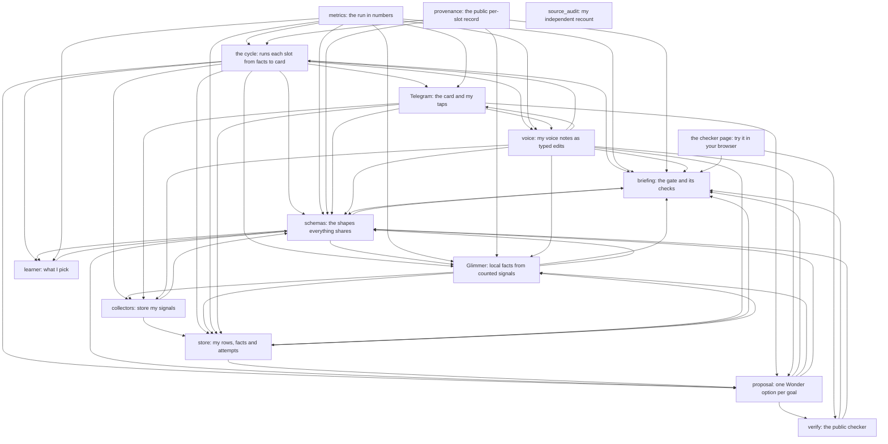

# Architecture

I drew the parts here so I can find them when I need them.

## Components

I read the import lines, and each arrow is a package importing from another. I left blocks, tryit, domains and rater out so the picture fits, and source_audit stands alone because it shares no code with the product.

## The pieces

This is the design in more detail, and Status says what exists.

1. Two goals compete for the same hour: Builder and Disconnect (family time, screens off).
2. Collectors store my own signals on my own machine.
3. Muse Glimmer, an open-weight model on my own hardware, turns them into facts that cite their events.
4. Muse Wonder, through Muse Code headless on my subscription, sees only those facts and my commitments, and proposes one commitment per goal for the next free slot.
5. A deterministic gate with no model and no network rejects whatever it can't reconcile.
6. A Telegram card offers both proposals and I choose with a tap.
7. A voice note corrects the system and the next card changes. Its audio goes through Muse Code on my subscription for transcription, and nothing on the voice path calls the API directly; raw screen, calendar and GitHub rows stay on my machine.

## Code off the card path

Apple Health ingest, the Spotify collector and framework/blocks/ were built earlier in the hackathon. The current design doesn't use them.

