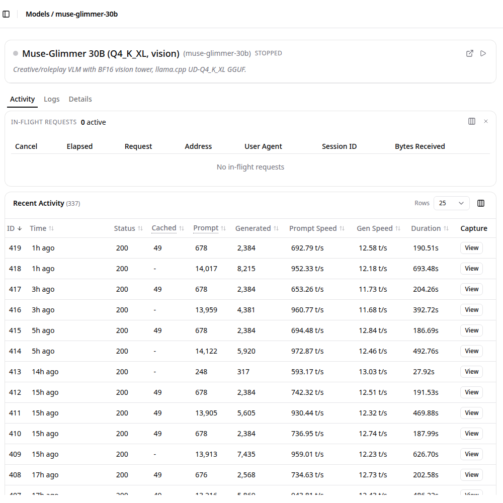
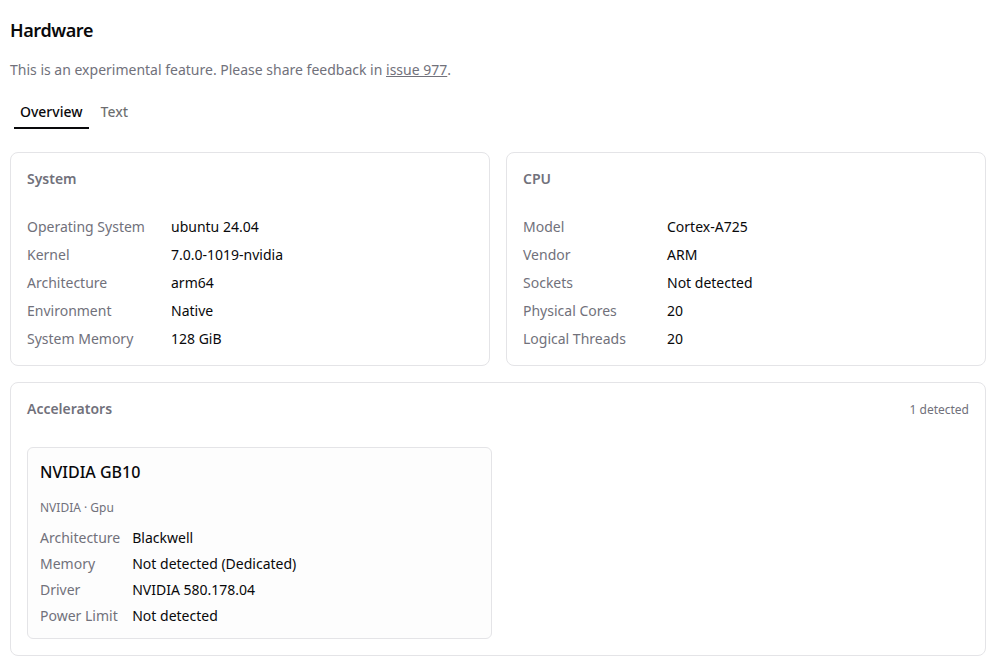

# Muse Glimmer on my own hardware: the evidence

Muse Glimmer (`muse-glimmer-30b`, Meta's open weights in Unsloth's UD-Q4_K_XL GGUF) runs on llama.cpp behind llama-swap on my own machine, an NVIDIA DGX Spark (GB10). On every live card it turns my records into facts the card can cite, in two passes. This page collects what the hackathon's office hours suggested: screen captures of the model serving, a sample output, and a run log with the model name and quantization.

## Screen captures (Nov 3, 16:59 Madrid)

llama-swap's own page for the model: 337 requests, all answered with status 200; a pair at each card's build (about 680 and about 14,000 prompt tokens, the two passes); generation at about 12 tokens a second.



llama-swap's hardware page: an NVIDIA GB10 (Blackwell) GPU, a 20-core ARM CPU, 128 GiB of memory, Ubuntu 24.04, running natively.



Both are cropped to the main panel. The request contents were not opened, and the machine's address is not shown.

## Run log: make glimmer-proof (Nov 3, 18:28 Madrid)

```
weights=Muse-Glimmer-30B-UD-Q4_K_XL.gguf
corroborated=yes
alias=muse-glimmer-30b
front_door=llama-swap
runtime=llama.cpp
quant=UD-Q4_K_XL
resident=no
endpoint=POST /v1/chat/completions
tls=yes
host=private
synthetic_title=Sprint planning
synthetic_label=iki-meeting
valid=yes
matched=yes
latency_s=31.2
completion_tokens=317
tokens_per_second=10.2
finish_reason=stop
verdict=OK
latency_note=latency includes any wait behind another request because Glimmer serves one at a time
```

`make glimmer-proof` asks the served model to label one made-up calendar title, then reads the served weights' file name back from llama-swap. It refuses to run inside a live card's Glimmer window. Here the model wasn't loaded yet (`resident=no`), so the 31.2 seconds include loading it.

## Per card

[`docs/provenance.jsonl`](provenance.jsonl) has one line per delivered card, with the facts step and how many of the card's claims cite Glimmer's facts. The real facts stay private: they are about my own records.

## Sample outputs on made-up data

[`evals/r10_results/muse-glimmer-30b.jsonl`](../evals/r10_results/muse-glimmer-30b.jsonl) holds Glimmer's labels for 80 invented calendar titles (R10: 77 of 80 correct).
